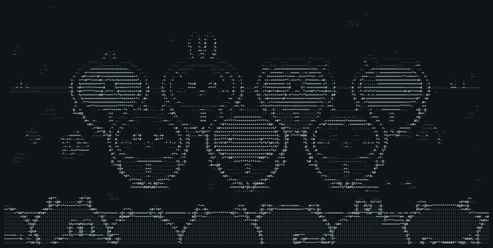

# Chiikawa ASCII Dance

Chiikawa dancing in your terminal. I liked the GIF, so I turned it into ASCII.



## Run
Python 3. No extra packages to install.

Download this repo, open a terminal in the folder, and run:

```bash
python chiikawa_dance.py
```

On Windows, you can also use:

```powershell
py chiikawa_dance.py
```

Press **Ctrl+C** when you're done watching.

## Make it more detailed

Maximize your terminal and shrink the font, then try:

```bash
python chiikawa_dance.py --width 240
```

The preview above uses 240 columns. You can go up to 320 if your terminal has room:

```bash
python chiikawa_dance.py --width 320
```

Without `--width`, it picks a size that fits your terminal. Sizes available: 48, 64, 80, 100, 120, 160, 200, 240, and 320.

## Other options

```bash
# Play a little faster
python chiikawa_dance.py --speed 1.5

# Play once
python chiikawa_dance.py --once

# Print a single frame
python chiikawa_dance.py --width 120 --frame 0
```

All 71 frames are built into the script, so it works offline. It uses the original GIF's frame timing.

## Credit

Chiikawa and the original animation belong to their respective creators. This is a fan project.
